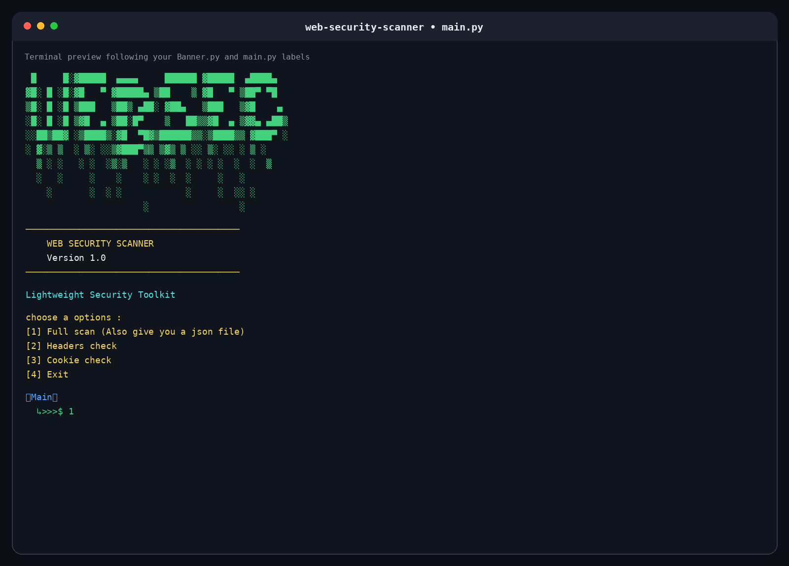
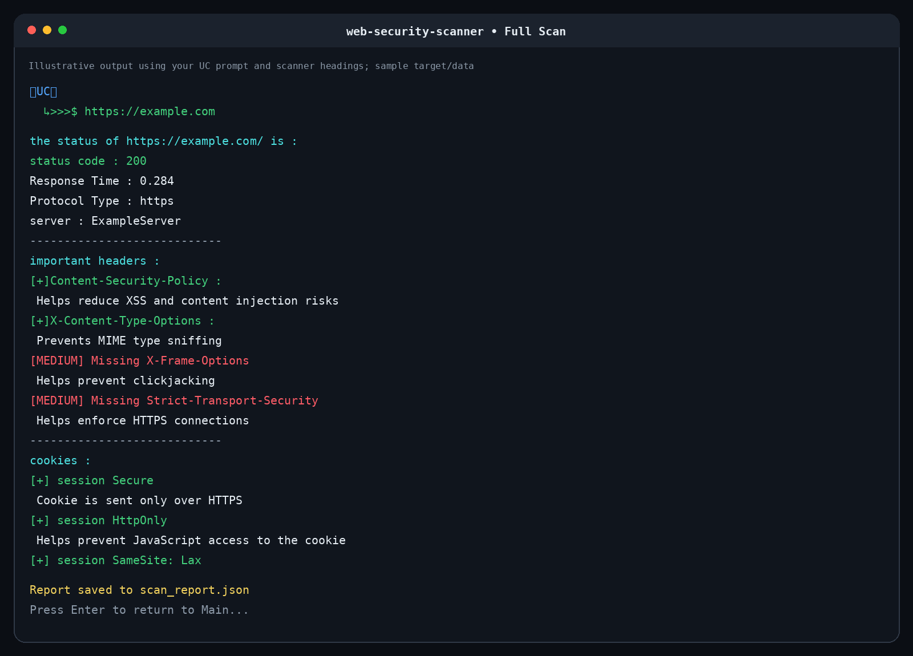
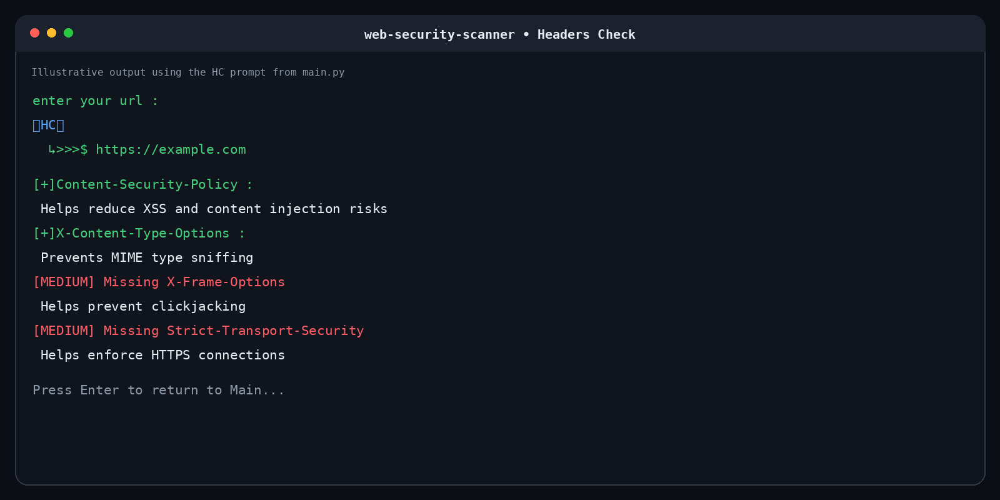
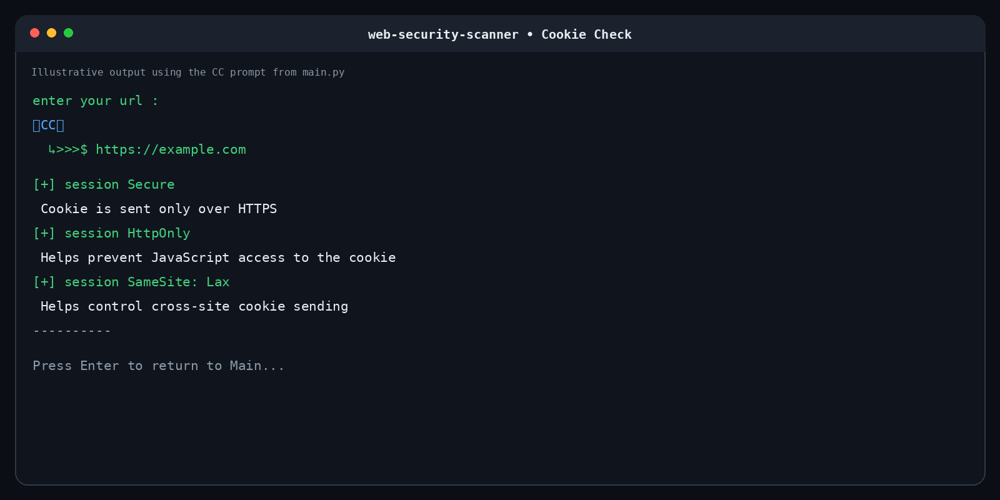
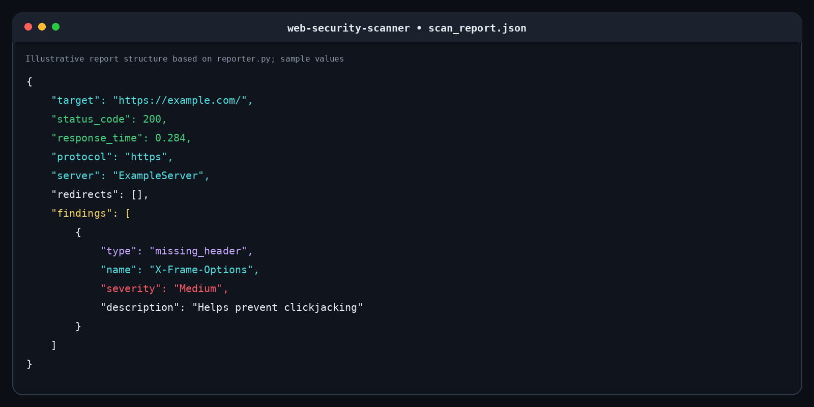

# Web Security Scanner

A lightweight Python command-line tool for checking selected HTTP security headers, cookie attributes, response metadata, and redirects. It also exports a JSON report for a full scan.

**Version:** 1.0  
**Language:** Python  
**Purpose:** Learning and authorized defensive security checks

> The screenshots in this README are illustrative terminal previews using the labels and prompt style from the project code. Their example target and response values are sample data, not results from a real scan.

## Features

- **Full scan:** gathers response metadata, checks selected security headers and cookie attributes, and saves a JSON report.
- **HTTP response information:** status code, response time, protocol, and `Server` header.
- **Security header checks:**
  - `Content-Security-Policy`
  - `X-Content-Type-Options`
  - `X-Frame-Options`
  - `Strict-Transport-Security`
- **Cookie attribute checks:** `Secure`, `HttpOnly`, and `SameSite`.
- **Redirect inspection:** shows redirect status codes and URLs.
- **JSON reporting:** saves findings and scan metadata to `scan_report.json`.
- **Interactive terminal menu:** full scan, headers check, cookie check, or exit.

## Screenshots

### Main menu and custom terminal banner



### Full scan



### Headers check



### Cookie check



### JSON report



## Requirements

- Python 3.8+
- `requests`
- `colorama`
- Optional: `neofetch` for the system information shown by the banner

## Installation

Clone your repository and enter the project directory:

```bash
git clone <https://github.com/sa-amin/web-security-scanner>
cd web-security-scanner
```

Create a virtual environment (recommended).

**Windows PowerShell**
```powershell
python -m venv .venv
.venv\Scripts\Activate.ps1
```

**Linux / macOS / WSL**
```bash
python3 -m venv .venv
source .venv/bin/activate
```

Install dependencies:

```bash
pip install -r requirements.txt
```

If you do not have a `requirements.txt` yet, create one with:

```text
requests
colorama
```

## Run

From the repository root:

```bash
python main.py
```

The menu provides:

1. **Full scan** — runs the combined checks and writes `scan_report.json`.
2. **Headers check** — checks selected security headers.
3. **Cookie check** — inspects cookie attributes.
4. **Exit** — closes the application.

Enter a URL when prompted. The scanner adds `https://` if no HTTP scheme is provided.

## Project structure

```text
web-security-scanner/
├── main.py
├── requirements.txt
├── README.md
├── scan_report.json          # generated by a full scan
├── assets/
│   ├── main-menu.png
│   ├── full-scan.png
│   ├── headers-check.png
│   ├── cookie-check.png
│   └── json-report.png
└── scanner/
    ├── __init__.py
    ├── Banner.py
    ├── url_checker.py
    ├── headers_checker.py
    ├── cookie_checker.py
    └── reporter.py
```

Adjust this tree if your local repository differs.

## Example JSON report

The following is a fictional example showing the report structure:

```json
{
  "target": "https://example.com/",
  "status_code": 200,
  "response_time": 0.284,
  "protocol": "https",
  "server": "ExampleServer",
  "redirects": [],
  "findings": [
    {
      "type": "missing_header",
      "name": "X-Frame-Options",
      "severity": "Medium",
      "description": "Helps prevent clickjacking"
    }
  ]
}
```

## Limitations

- This is an early learning project, not a comprehensive vulnerability scanner.
- A missing security header or cookie attribute is a configuration finding to review, not proof by itself that a site is exploitable.
- `SameSite=None` is not inherently a vulnerability; cookie behavior depends on the application and context.
- Cookie checks are based on cookies exposed by the HTTP response object and may not cover every cookie involved in a redirect chain.
- The scanner does not replace a professional security review or a full web application security testing suite.

## Responsible use

Only scan websites and systems you own or have explicit permission to assess. This project is intended for learning and authorized defensive testing.

## Roadmap

- [ ] Add automated tests for URL validation and header/cookie checks
- [ ] Improve input validation and error handling
- [ ] Support timestamped reports and a configurable report path
- [ ] Add more security-header checks with clear explanations

## License

This project is licensed under the MIT License — see the [LICENSE](LICENSE) file for details.